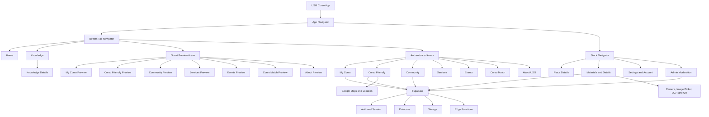

# USG Corso

**[React Native](https://reactnative.dev/) Regular Exam Project at [SoftUni](https://softuni.bg/)**

**Author:** Stefan Tananov  
**SoftUni Username:** `tanashi`

USG Corso is a mobile application for Cane Corso owners, enthusiasts and people who want useful information about the breed in one place.

The app combines personal dog profiles, community content, useful places, educational materials and mobile tools.

The project is developed for the [React Native](https://reactnative.dev/) Regular Exam at [SoftUni](https://softuni.bg/). After the exam, it is planned to become part of the wider **USG Cane Corso Platform**.

**USG Cane Corso Platform:**  
https://usg-cane-corso-platform.com/

---

## Jump to

- [APK](#apk)
- [Exam Status](#exam-status)
- [Visual Project Scheme](#visual-project-scheme)
- [Functional Guide](#functional-guide)
- [Technology](#technology)
- [Run Instructions](#run-instructions)
- [Development Status](#development-status)

---

## APK

**Final Exam APK:**  
The final APK download link will be added here before submission.

The SoftUni requirements state that the project must include a working APK link in the README.

The project will not be submitted without this link.

---

## Exam Status

Current status:

- Navigation: implemented
- Authentication: implemented
- Session persistence: implemented
- Supabase backend: implemented
- CRUD operations: implemented
- Pull-to-refresh: implemented
- Forms and validation: implemented
- Native mobile features: implemented
- Functional Guide: included below
- Final exam APK: pending final build

---

# Visual Project Scheme



The application uses a Bottom Tab Navigator for the main areas and a Stack Navigator for details, settings, materials and admin screens.

Knowledge is public educational content. Other public tabs can show limited guest previews, while personal actions and user-owned data require authentication.

Supabase provides authentication, database data, storage and Edge Functions. Native mobile features include Google Maps, device location, camera, image selection, OCR and QR support.

---

# Functional Guide

## 1. Project Overview

**Application Name:** USG Corso

**Category:** Cane Corso / Community / Education / Mobile Utility

USG Corso gives Cane Corso owners and enthusiasts one mobile place for useful information and everyday breed-related tools.

The app includes dog profiles, useful places, educational content, community features and user materials.

The project uses a real backend and native mobile features.

---

## 2. User Access & Permissions

### Guest

USG Corso is designed with a production-oriented access model.

A guest can access limited public content without creating an account.

The main public area is **Knowledge**, because educational information about the breed should remain easy to access.

Personal data and account-based actions stay protected.

A guest cannot manage personal dog profiles, private user data, submissions or moderation tools.

### Authenticated User

A logged-in user can use the personal and community features of the application.

Depending on the section, the user can:

- create, view, edit and delete Cane Corso profiles
- upload and manage dog photos
- submit materials
- propose Cane Corso Friendly places
- open list and details screens
- use location, map, camera and image tools

Admin users have additional moderation screens for supported public content.

---

## 3. Authentication & Session Handling

USG Corso uses **Supabase Auth**.

The authentication flow includes:

- registration
- login
- logout
- email confirmation
- forgotten password recovery
- setting a new password

Supabase manages the authenticated session.

When the application is restarted, an existing valid session can be restored automatically.

Protected personal actions require authentication.

---

## 4. Navigation Structure

The application uses two main React Navigation navigator types:

- Bottom Tab Navigator
- Native Stack Navigator

The bottom tabs give access to the main application areas.

The Stack Navigator is used for details screens, settings, materials, administration and other screens opened from the main areas.

The project contains more than five screens.

It also contains several dynamic details screens.

---

## 5. List → Details Flow

USG Corso has several list-to-details flows.

Examples:

- places list → place details
- materials list → material details
- Knowledge list → Knowledge details
- admin moderation list → moderation details

Details screens receive an ID or object through route parameters.

---

## 6. Data Source & Backend

USG Corso uses **Supabase** as a real backend.

Supabase is used for:

- authentication
- database records
- file storage
- moderation data
- application counters
- Edge Functions

Main application data is fetched from the backend.

The project does not use hardcoded JSON as the main source of application data.

---

## 7. Data Operations

The application contains real CRUD operations.

### Read

Data is fetched from Supabase and displayed in lists and details screens.

### Create

Authenticated users can create supported content such as:

- Cane Corso profiles
- place proposals
- user materials

### Update

Users can edit supported content that belongs to them.

Admin users can update supported moderation data.

### Delete

Users can delete supported content that belongs to them where the application flow allows it.

Admin users can also delete supported moderated content.

### Pull-to-Refresh

Server-backed list screens use pull-to-refresh where appropriate.

This allows the user to load fresh data from the backend.

---

## 8. Forms & Validation

The project includes forms for:

- registration
- login
- password recovery
- user profile
- My Corso
- place proposals
- user materials

The forms validate different types of fields.

Examples:

- email must have a valid format
- required fields cannot be empty
- password uses several rules

Password validation includes:

- required value
- minimum length
- uppercase letter
- lowercase letter
- number
- special character

The application also uses controls beyond normal text inputs, including:

- switches
- selectors
- image selection
- date-related input
- map-based coordinate selection

Forms are designed for mobile use.

They use safe-area and keyboard-aware layouts where needed.

---

## 9. Native Device Features

USG Corso uses several mobile-specific features:

- Camera
- Image Picker
- Device Location
- Google Maps
- OCR from images
- QR detection

Camera and Image Picker are used for photos and materials.

Location and Google Maps are used in the Corso Friendly place workflow.

OCR can extract text from selected images.

The OCR workflow supports Bulgarian, English and Italian.

---

## 10. Typical User Flow

A normal user journey can be:

1. Open the application.
2. Browse public Knowledge content or log in.
3. Open a main section.
4. Load existing data or create new content.
5. Open a details screen.
6. Edit, delete or submit content where the current flow allows it.

---

## 11. Error & Edge Case Handling

The application handles common states such as:

- authentication errors
- network and backend errors
- loading states
- empty lists
- missing data
- invalid form values
- confirmations
- success messages

Normal application feedback uses the USG visual style.

---

## 12. APK / Build

The project is tested with an Android Development Build during development.

A standalone Android preview build profile is also configured.

The final exam APK link will be added at the top of this README before submission.

The project will not be submitted without the APK link.

---

# Current Implementation

The current version includes:

- 3D USG intro
- dark and light themes
- Bulgarian, English and Italian UI
- saved language preference
- saved theme preference
- Home screen with main USG sections
- Bottom Tab navigation
- Stack navigation
- Settings
- Help
- Legal information
- Supabase Auth
- persisted sessions
- email confirmation
- password recovery
- user profile data
- My Corso CRUD
- dog photo upload with Supabase Storage
- Community Corso sharing and moderation
- user materials
- material editing and deletion
- admin content moderation
- camera and image selection
- OCR-assisted text capture
- QR detection
- native Android Google Map
- current device location
- approved place markers
- category filtering
- place proposal workflow
- reverse geocoding through Supabase Edge Function
- admin place moderation
- account deletion flow
- Supabase-backed Home counters
- branded USG dialogs
- Android Development Build support
- standalone Android preview build support

Some areas are still being expanded.

They are not presented as finished backend directories when the backend functionality is not complete.

---

# Main Application Areas

## My Corso

My Corso is the personal Cane Corso area.

Users can create, view, edit and delete dog profiles.

Dog photos are stored with Supabase Storage.

Users can also choose whether a dog can be shared with the community.

---

## Corso Friendly

Corso Friendly is the place discovery area.

It includes:

- Google Maps
- current device location
- approved place markers
- place categories
- place details
- place proposals
- reverse geocoding
- admin moderation

---

## Knowledge

Knowledge is the public educational area.

It contains Cane Corso information and uses a list-to-details flow.

This section is intentionally accessible without login because it contains public educational content.

---

## Community

Community contains approved public Cane Corso profiles shared by owners.

Public content follows moderation rules before it is shown.

---

## Professionals & Services

This area is prepared for useful Cane Corso services.

Current categories include:

- Breeders
- Trainers
- Veterinary
- Handlers
- Transport
- Pet Shops

A full backend directory is planned for later development.

---

## Events

This area is prepared for:

- Dog Shows
- Seminars
- Lectures
- Training Events
- Breed Meetings

A full live events backend is planned for later development.

---

## Corso Match

Corso Match is planned as an educational feature.

Its purpose is to help a person understand whether the Cane Corso is suitable for their lifestyle.

It is not a breeding or mating feature.

---

## About USG

This area explains the idea and philosophy behind USG.

---

# Technology

The project currently uses:

- [React Native](https://reactnative.dev/)
- Expo
- React
- JavaScript
- React Navigation
- Supabase
- Supabase Auth
- Supabase Database
- Supabase Storage
- Supabase Edge Functions
- AsyncStorage
- Expo Location
- React Native Maps
- Google Maps
- Expo Image Picker
- Expo Camera
- Expo File System
- Expo OCR Kit
- Expo Linking
- Expo Dev Client
- EAS Build
- Expo GL
- Three.js
- Safe Area Context

---

# Environment Configuration

The repository contains `.env.example`.

Create a local `.env` file with:

```text
EXPO_PUBLIC_SUPABASE_URL=
EXPO_PUBLIC_SUPABASE_PUBLISHABLE_KEY=
GOOGLE_MAPS_ANDROID_API_KEY=
```

The real `.env` file must remain local.

It must not be committed to GitHub.

---

# Run Instructions

Clone the repository:

```bash
git clone https://github.com/SATananov/USGCorso.git
```

Open the project:

```bash
cd USGCorso
```

Install dependencies:

```bash
npm install
```

Create the local `.env` file from `.env.example`.

Start Expo:

```bash
npx expo start
```

For a clean Metro start:

```bash
npx expo start -c
```

Native Android functionality should be tested with the configured Android Development Build or preview build.

Expo Go is not the main verification environment for the native project features.

---

# Development Status

## Working Now

The project currently has working:

- navigation
- authentication
- persisted sessions
- Supabase data
- CRUD flows
- validation
- pull-to-refresh
- image tools
- location
- maps
- moderation
- Android Development Build support
- standalone preview build support

## Still in Development

Planned or incomplete areas include:

- real push notifications
- deeper backend privacy controls
- place favorites and reviews
- wider public services directory
- wider events directory
- full Corso Match logic
- wider community interaction
- final exam APK
- integration with the wider USG Cane Corso Platform

---

# About USG

**USG — Unico Suo Genere™**

USG is a cultural and educational Cane Corso project.

The idea is based on knowledge, history, responsibility and respect for the breed.

It is not designed as a dog-selling marketplace.

**FUNZIONE CREA IL TIPO**

---

# Repository

https://github.com/SATananov/USGCorso

---

# Author

**Stefan Tananov**

---

# Rights

**USG — Unico Suo Genere™**  
All rights reserved.
