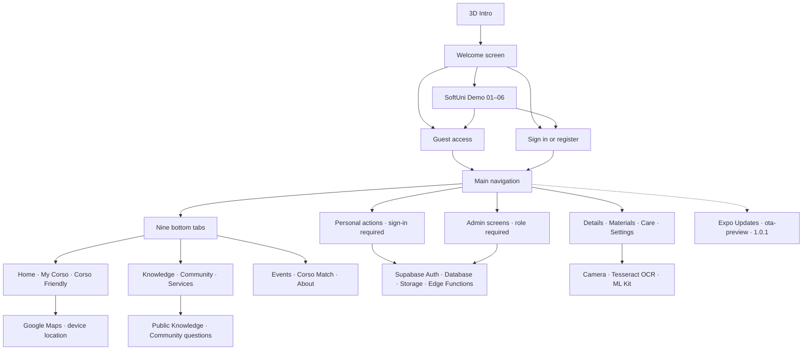

# USGCorso

**[React Native](https://reactnative.dev/) Regular Exam Project at [SoftUni](https://softuni.bg/)**

**Author:** Stefan Tananov

**SoftUni username:** `tanashi`

USG Corso is an Android application for Cane Corso owners, enthusiasts and people who want reliable breed information in one place. Built with **React Native**, **Expo** and **Supabase**, it combines personal dog profiles, community content, educational materials, useful places and practical mobile tools.

This is the exam edition of an ongoing project, developed for the **SoftUni React Native Regular Exam**. It is intended to grow into part of the [USG Cane Corso Platform](https://usg-cane-corso-platform.com/) — a cultural and educational initiative, not a dog-selling marketplace.

## Examiner Quick Start

1. Download [USGCorso_1.0.1_SoftUni.apk](https://github.com/SATananov/USGCorso/releases/download/softuni-v1.0.1/USGCorso_1.0.1_SoftUni.apk) from the [official GitHub release](https://github.com/SATananov/USGCorso/releases/tag/softuni-v1.0.1).
2. Install it on an Android phone or emulator and open **USG Corso**. The release APK runs without Metro.
3. Complete the 3D intro and tap **Continue**. On the welcome screen, choose **SoftUni Demo** to open the 01–06 examiner menu. Signed-in demo users can reopen it with the floating **SOFTUNI** button.
4. Choose a section to follow its walkthrough. Demo account details are below in [SoftUni Demonstration](#softuni-demonstration).

Supabase features require an internet connection. For full emulator setup, see [Android Studio — Setup & Run](#android-studio-setup-and-run) and the [Examiner Guide](EXAMINER_GUIDE.md).

[↑ Back to top](#jump-to)

---

## Jump to

- [Examiner Quick Start](#examiner-quick-start)
- [Download Android APK](#download-android-apk)
- [SoftUni Demonstration](#softuni-demonstration)
- [Android Studio — Setup & Run](#android-studio-setup-and-run)
- [OTA Updates](#ota-updates)
- [Project Architecture](#project-architecture)
- [SoftUni Requirements](#softuni-requirements)
- [Functional Guide](#functional-guide)
- [Main Features](#main-features)
- [OCR & Translation](#ocr-and-translation)
- [Technology](#technology)
- [Development Status](#development-status)
- [Examiner Guide](EXAMINER_GUIDE.md)
- [Author](#author)

## Download Android APK

The exam release is **USG Corso 1.0.1** (`com.usgcorso.mobile`, Android `versionCode` 6, EAS profile `examOta`).

- [Download USGCorso_1.0.1_SoftUni.apk](https://github.com/SATananov/USGCorso/releases/download/softuni-v1.0.1/USGCorso_1.0.1_SoftUni.apk)
- [GitHub release page](https://github.com/SATananov/USGCorso/releases/tag/softuni-v1.0.1)
- SHA-256: `21A060AA918CBB14242505817C6D57133C1355E9C927ED1A616BD82F67FAC667`

The release URLs returned HTTP 200, and the APK downloaded from GitHub matched the original SHA-256. The APK was built from an earlier source revision than the current documentation; its release details identify that build. It uses the original EAS signing certificate. Android APKs require a phone or emulator; they do not run directly on Windows.

**Build details:** The APK was built from source commit `9abdad6ba8a7a90cd4da46195dd03d62929a1ec0`. This is separate from later documentation changes on `main`. The release build used version `1.0.1` and version code `6`; the current source `app.json` says version code `5`, which the `examOta` profile overrides to `6`. `package.json` currently reports `1.0.0`.

[↑ Back to top](#jump-to)

---

## SoftUni Demonstration

The demo menu groups the exam walkthrough into six sections. It uses the normal application sign-in flow and does not bypass authentication.

| Section | What to inspect |
| --- | --- |
| 01 — Navigation | Main tabs, public Knowledge list and item details |
| 02 — Authentication | Sign-in, registration, session persistence and protected routes |
| 03 — Data operations | My Corso and My Materials records, including supported create, edit, delete and refresh flows |
| 04 — Forms | Registration, material forms and validation feedback |
| 05 — Mobile features | Camera and image selection, OCR, location and map features (permissions/device dependent) |
| 06 — Build & presentation | Repository, README and APK distribution; this is an extra presentation section |

The dedicated exam accounts are temporary and intended for evaluation only. They use experimental data; do not enter personal information. Sign out before switching accounts.

| Role | Email | Password |
| --- | --- | --- |
| Regular user | `SoftUniUser@demo.com` | `SoftUniUser123!@#` |
| Administrator | `SoftUniAdmin@demo.com` | `SoftUniAdmin123!@#` |

To sign in, choose **SoftUni Demo** on the welcome screen, then **Test real sign in**, and enter an account above. After the exam, disable these accounts and remove their credentials from public documentation; password rotation is also recommended because Git history retains earlier versions.

[↑ Back to top](#jump-to)

---

## Android Studio Setup and Run

### Run the Published APK — Recommended for Examiners

1. Install Android Studio with Android SDK, Platform Tools (`adb`) and Android Emulator.
2. In **Device Manager**, create and start a phone AVD with a compatible x86_64 system image. Complete device setup and wait for boot.
3. Download the official APK linked above.
4. In PowerShell, confirm the emulator serial and boot state:

```powershell
adb devices -l
$serial = 'emulator-XXXX' # Replace with the serial listed above
adb -s $serial shell getprop sys.boot_completed
```

The boot property should return `1`. Install by dragging the APK onto the running emulator, or use:

```powershell
$apk = Join-Path $HOME 'Downloads\USGCorso_1.0.1_SoftUni.apk'
adb -s $serial install $apk
adb -s $serial shell am start -n com.usgcorso.mobile/.MainActivity
```

The release APK is standalone and needs no Metro server. Open **Continue**, then **SoftUni Demo**. Internet is required for Supabase-backed content. Use a test device or emulator: a development build may use a different signing certificate but the same package name, which can prevent an in-place update. Check before replacing an installation; uninstalling can erase local data.

### Run From Source — Development

Requirements: Git, Node.js/npm, VS Code, Android Studio with SDK and Platform Tools, and a running Android emulator. From PowerShell:

```powershell
git clone https://github.com/SATananov/USGCorso.git
cd USGCorso
code .
npm ci
Copy-Item .env.example .env
```

Add the required local Supabase URL, publishable key and Android Maps API key to `.env`; do not commit real credentials. Start the emulator, then create and launch a native Development Build:

```powershell
npx expo run:android
```

Start the Metro development server in a separate terminal:

```powershell
npx expo start --dev-client
```

For a clean Metro cache, use `npx expo start --dev-client -c`. Open the Development Build on the emulator and connect it to Metro. Native module or dependency changes require a new Development Build. Expo Go does not include all native modules used by this project.

**Troubleshooting:** Confirm `adb devices -l` lists a fully booted device. If install reports `INSTALL_FAILED_UPDATE_INCOMPATIBLE`, the installed app was signed differently; check for local data before considering removal. Maps builds require `GOOGLE_MAPS_ANDROID_API_KEY`. Supabase features need a valid `.env` and internet access.

[↑ Back to top](#jump-to)

---

## OTA Updates

Over-the-air (OTA) updates can deliver compatible JavaScript and asset changes to an installed app without installing a new APK. Changes to native code, modules or Android permissions need a new native build. The v1.0.1 exam APK uses the `ota-preview` channel and runtime version `1.0.1`; this preview channel is not a public Google Play release.

On 27 November 2026, a Samsung Galaxy A13 running the exam APK detected a test update, accepted it through **Update now**, and displayed the temporary Home label. A second OTA update restored the clean Home screen. Both updates were applied without installing a new APK.

[↑ Back to top](#jump-to)

---

## Project Architecture



The app opens with the 3D intro, then the welcome/auth gateway. Guests can browse Knowledge and see limited previews; personal features require a signed-in session. Admin stack screens additionally check the user's role. These client-side route checks do not replace backend authorization. Expo Updates deliver compatible JavaScript and assets; native changes require a new build.

[↑ Back to top](#jump-to)

---

## SoftUni Requirements

The provided SoftUni exam specification assigns **100 points** to five technical areas. The examples below show where the implementation can be inspected; they are not a claim of a particular exam score.

| Requirement | Project evidence |
| --- | --- |
| **Navigation and structure — 20 pts** | React Navigation combines a bottom-tab navigator with a native stack. Nine tabs, detail screens and route parameters are available; see the Functional Guide. |
| **Authentication and sessions — 15 pts** | Supabase registration, login, logout, protected personal/admin routes and persistent sessions. **Guest-visible content is an intentional exception** to the specification's auth-only signed-out flow. |
| **Data and CRUD — 25 pts** | Supabase-backed lists, pull-to-refresh and create/read/edit/delete flows in My Corso and My Materials, with loading and error states. |
| **Forms and input — 20 pts** | Registration validates email, password and confirmation. My Corso uses a switch; care forms use selection and date controls. Keyboard and safe-area handling are implemented where needed. |
| **Native features — 20 pts** | Camera, image picker, device location and Google Maps produce application results. OCR and on-device translation are additional features. |

The repository includes a [published APK](#download-android-apk), source setup instructions and this **Functional Guide**, as required for submission. The Git history also contains meaningful commits across multiple days. Section **06** of the in-app SoftUni Demo is a presentation aid, not an extra graded category.

[↑ Back to top](#jump-to)

---

## Functional Guide

### Navigation and access

The root flow restores authentication state, displays the intro and welcome/auth gateway, then opens the main app. React Navigation composes a **Bottom Tab Navigator** and a **Native Stack Navigator**. The nine tabs are Home, My Corso, Corso Friendly, Knowledge, Community, Services, Events, Corso Match and About. The stack opens item details, materials, care tools, settings, help, legal information and administration. The app contains more than five reachable screens, including dynamic details screens.

Knowledge is public, and Community questions can be browsed publicly. Guests see limited previews of other areas. Personal records and actions require sign-in; administrative screens also check the Supabase role. Guest access is intentional product behavior and differs from a specification that requires only authentication screens while signed out.

### Authentication and sessions

Supabase Auth supports registration, sign-in/out, email confirmation and password recovery. Sessions persist through AsyncStorage with token refresh. Registration may require email confirmation before sign-in. A cold start restores a saved session; verify this behavior on the installed exam APK as part of evaluation.

### Backend and CRUD

Supabase provides authentication, database records, file storage and Edge Functions. For example, My Corso mutations save dog profiles and photos and reload the list from the backend. My Materials supports authenticated create, read, edit, delete and refresh flows. Users can submit Community questions and replies; public content may be subject to moderation. Admin tools handle supported content and professional access approvals. Available mutations depend on the section and backend policies.

List-to-detail examples include Knowledge → `KnowledgePublicDetails` (`item`), Corso Friendly → `PlaceDetails` (`placeId`), and My Materials → `MyMaterialDetails` (`item`). Server-backed lists provide refresh where implemented.

### Forms and errors

Forms cover account access, dog profiles, materials, professional applications and place proposals. Registration validates **email** (required, valid format), **password** (at least six characters, upper/lowercase letters, a number and a special character), and **confirmation** (required and matching).

Beyond text fields, My Corso uses **switches** and the care screens use **date and selection controls**. The app uses safe-area layouts and keyboard-aware handling where needed, alongside loading, empty, error and success feedback. Try invalid registration input and a disposable material submission to inspect these states.

### Native device features

Corso Friendly uses Google Maps, device location, categories, place proposals, favorites and place reviews. Camera, image selection and QR detection use device features. Care History combines Supabase-backed records with local details, including health entries and some quantities. Care Calendar and reminders are stored on the device and use Android local notifications when permitted; these are not remote push notifications.

Tesseract OCR can extract Bulgarian, English and Italian text from selected or captured images. Its local OCR Test Lab is a diagnostic screen; recognition quality varies and text should be reviewed. Knowledge details can offer explicit Google ML Kit on-device translation among Bulgarian, English and Italian. Models download when needed; the current Android implementation requires Wi-Fi for that download. Machine translations are labeled and the original text remains available.

### Typical user flow

1. Open the app, complete the intro and browse public Knowledge or sign in.
2. Choose **My Corso** or **My Materials** to load records from Supabase.
3. Open an item for details; create or edit a disposable record using a validated form.
4. Refresh the list to see server data, then delete the test record where the flow permits it.

Guest browsing is intentional, but it does not meet the specification's literal *auth screens only when signed out* condition. That difference is disclosed for the examiner rather than presented as full compliance.

[↑ Back to top](#jump-to)

---

## Main Features

| Feature | What it does |
| --- | --- |
| My Corso | Manage dog profiles and photos; open a zoomable photo viewer and use supported care, diary, growth, behavior, challenge and walk screens. |
| Corso Friendly | Browse categorized places on a map or list, use device location, view details, save favorites, submit place proposals, and rate or review places. |
| Knowledge | Browse public educational materials, open details and request on-device translation when available. |
| Community | View shared Cane Corso profiles and public questions, read replies, and submit questions or replies when signed in. Moderation applies to supported content. |
| My Materials | Create, read, edit, delete and refresh the signed-in user's materials. |
| Professionals & Services | Browse public professional profiles, manage an eligible user's profile and submit an access application for admin review. Public profile fields are visibility controlled. |
| Care History & Calendar | Track care with a mix of Supabase records and local details; keep the calendar and Android reminders on the device. |
| Admin | Review supported applications, places and community content; administrator routes check the user's role. |
| Settings & languages | Manage app preferences, account, privacy, notifications, help and legal information; the interface supports Bulgarian, English and Italian. |
| Events | Informational section screen; a live events directory is not implemented. |
| Corso Match | Informational section screen; the planned lifestyle suitability feature is not implemented. |

[↑ Back to top](#jump-to)

---

## OCR and Translation

- The custom native Tesseract module is in `modules/usg-ocr/`; `src/ocr/ocrService.js` exposes OCR to the app. The service and OCR Test Lab apply a 25-second JavaScript timeout.
- OCR supports Bulgarian (`bul`), English (`eng`) and Italian (`ita`). Results are local and require review; the Test Lab is diagnostic, not an accuracy guarantee.
- The Android module in `modules/usg-translate/` uses Google ML Kit Translate. Knowledge details offer a manual on-device translation action for Bulgarian, English and Italian. Language models download when required; the current implementation requires Wi-Fi for downloads.
- Translation is distinct from the older experimental Supabase translation queue in migration history. That migration is not evidence of a deployed cloud translator.

[↑ Back to top](#jump-to)

---

## Technology

- **App:** React Native, Expo SDK 58, JavaScript, React Navigation, TypeScript tooling (the app is primarily JavaScript).
- **Backend:** Supabase Auth, Database, Storage and Edge Functions; AsyncStorage for session persistence.
- **Android and device APIs:** Expo Camera, Image Picker, Location, Notifications and Updates; React Native Maps with Google Maps; custom Expo modules for Tesseract OCR and ML Kit Translate.
- **Build and graphics:** EAS Build, Expo Dev Client, Expo GL and Three.js.

[↑ Back to top](#jump-to)

---

## Development Status

The status below distinguishes features present in source code from what has been checked on the signed Android exam build.

### Implemented

Authentication and session persistence, the nine-tab app, Supabase-backed personal and community flows, place favorites and reviews, professional profiles and access applications, admin moderation, dog care records with local notifications, OCR and on-device translation are implemented in the source. Events and Corso Match currently show informational content only.

### Verified on device

The signed v1.0.1 APK signature, version, JavaScript bundle and OCR models were checked. On a Samsung Galaxy A13, standalone launch without Metro, navigation, sign-in, Google Maps and Knowledge were checked. OTA delivery and restoration of the clean Home screen were also confirmed on that device on 27 November 2026. These checks do not cover every feature or a full acceptance pass. The published release and APK checksums are documented above.

### Still in development

Planned or incomplete work includes a live Events directory, full Corso Match logic, broader community interaction and services coverage, deeper backend privacy controls, broader editorial review and translation coverage, and integration with the wider USG platform. OCR accuracy can vary on complex documents. Local care notifications are not a remote push notification system. Google Play publication has not occurred.

[↑ Back to top](#jump-to)

---

## About USG

**USG — Unico Suo Genere™** is a cultural and educational Cane Corso project built around knowledge, history, responsibility and respect for the breed. USGCorso is not a dog-selling marketplace.

[↑ Back to top](#jump-to)

---

## Links

- [USGCorso repository](https://github.com/SATananov/USGCorso)
- [Official SoftUni exam APK](https://github.com/SATananov/USGCorso/releases/tag/softuni-v1.0.1)
- [USG Cane Corso Platform](https://usg-cane-corso-platform.com/)
- [Examiner Guide](EXAMINER_GUIDE.md)

[↑ Back to top](#jump-to)

---

## Author

**Stefan Tananov**

SoftUni username: `tanashi`

**USG — Unico Suo Genere™**

© 2026 Stefan Tananov · USG. The repository also contains third-party software and license notices; see [LICENSE](LICENSE).
